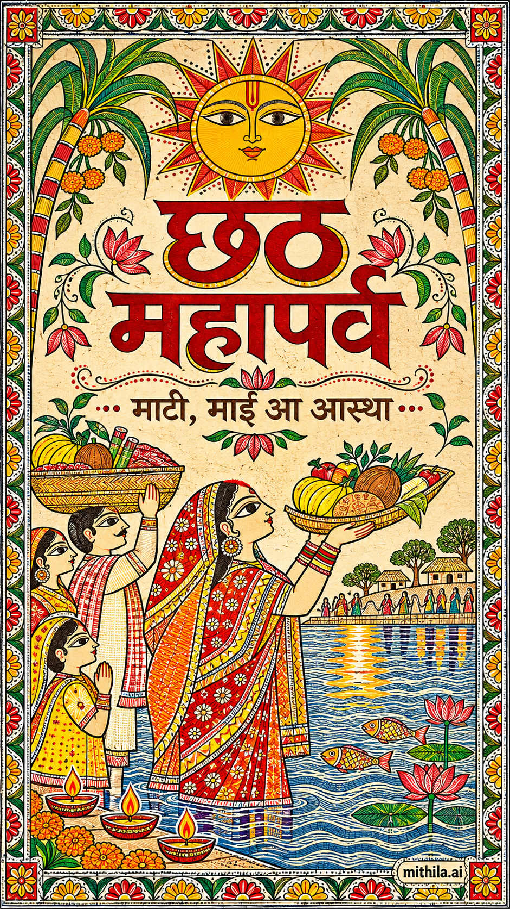
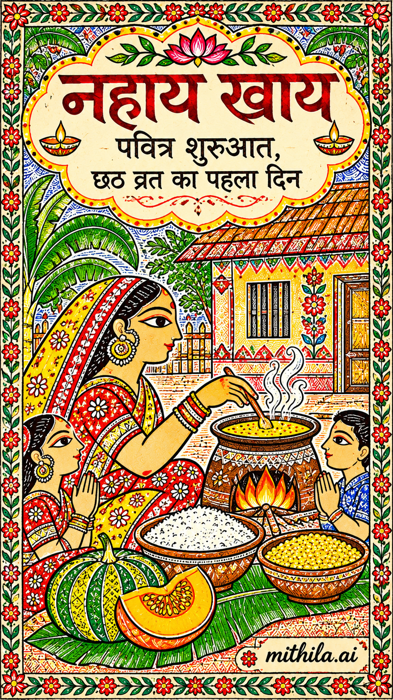
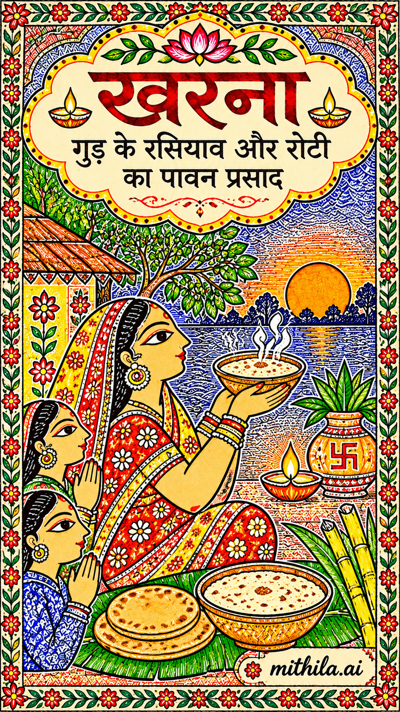
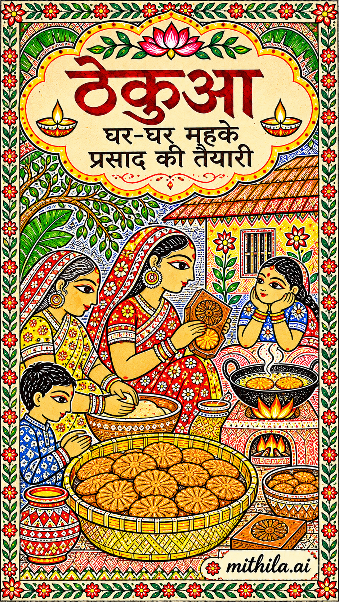
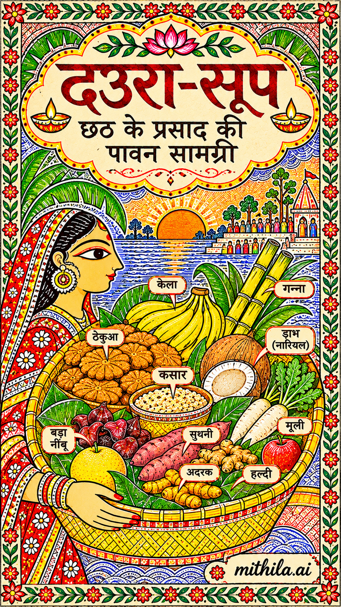
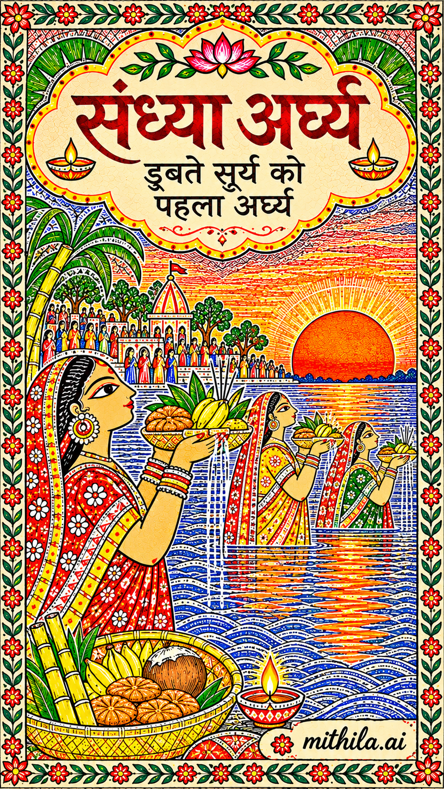
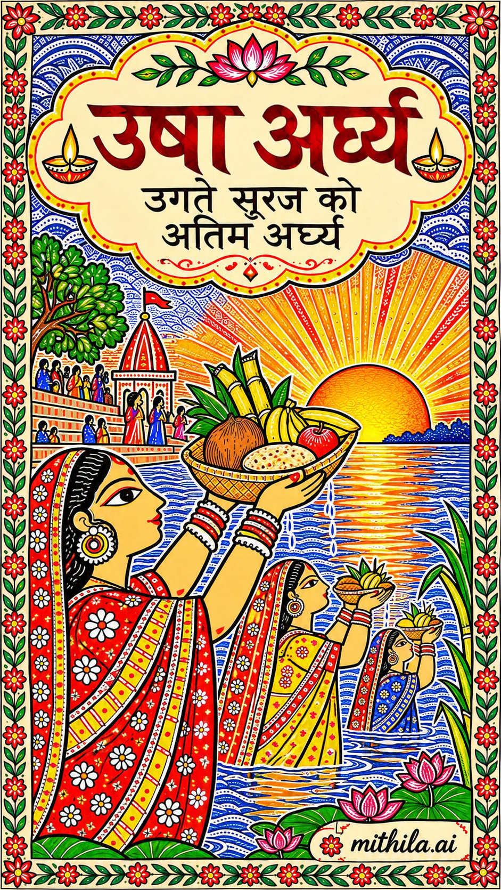

# Chatth Mahaparv

*Generated on November 14, 2026*

**ENGLISH:**

In the heartland of Bihar, where the Ganges whispers ancient secrets, the air thrums with life as the sun dips below the horizon. This is the Chhath Mahaparv, a time when the very soul of a people converges in devotion to Surya Dev and Chhathi Maiya, the guardians of health and prosperity. Families unite, warming the hearths with modest mutta kaddu-bhaat, setting the foundation for a fast that is both a spiritual and corporeal purification, a pilgrimage of hearts towards the divine luminescence of the sun.

As the ritual journey deepens, the second evening transforms the ghats into sanctuaries of golden twilight. The Sandhya Arghya is more than an offering; it's an ode to the vanishing light, a poignant reminder that the setting sun is as gracious as its rising counterpart. In these sacred moments, echoes of ancient songs mingle with the scent of earth and water, harmonizing with the intricate brushstrokes of Mithila art that adorn the backdrops, storytelling in every line and spiral.

Guided by the first tender hues of dawn, devotees awaken the world with the sonorous melodies of Chhath. Usha Arghya, a hymn to the newborn day, unfolds as prayers interlace with the rays that touch the horizon. The fast breaks, and with it flows a river of gratitude and prasad, binding families closer, encircling them in the universal embrace of tradition, carrying forward the living tapestry of faith that is Chhath, painted with the colors of Mithila art.

---

**HINDI:**

## Hindi Summary

बिहार की धरा पर, जहाँ गंगा पुरातन रहस्यों को फुसफुसाती है, सूर्यास्त होते ही हवा जीवन से भर उठती है। यह है छठ महापर्व का समय, जब लोग एक होकर सूर्य देव और छठी मइया की आराधना करते हैं, जो सेहत और समृद्धि की रक्षा करते हैं। परिवार एक साथ मिलकर मट्टा कद्दू-भात पकाते हैं, जो उस उपवास की नींव रखता है, जो आध्यात्मिक और शारीरिक शुद्धि का प्रतीक है, दिलों की एक यात्रा जो ईश्वरीय प्रकाश की ओर अग्रसित होती है।

जैसे-जैसे विधि का सफर गहराता है, दूसरी शाम घाटों को सुनहरी संध्या में परिवर्तित कर देती है। संध्या अर्घ्य केवल अर्पण नहीं है; यह अस्त होते सूर्य का गीत है, यह याद दिलाता है कि डूबता हुआ सूरज भी उतना ही पूजनीय है जितना उगता हुआ। इन पवित्र पलों में पौराणिक गीतों की गूँज मिट्टी और पानी की खुशबू के साथ घुलमिल जाती है, मधुबनी कला के जटिल चित्रण के साथ जो हर रेखा और कुंडली में कहानी बुनते हैं।

पहली कोमल भोर की किरणों से प्रेरित हिन्दुओं की सुरीली स्वर लहरियों से संसार जाग उठता है। ऊषा अर्घ्य, नवजात दिन के लिए एक भजन है, जहाँ प्रार्थनाएँ और क्षितिज को छूती किरणें आपस में मिलती हैं। उपवास खुलता है, और इसके साथ बहता है कृतज्ञता व प्रसाद का धार्मिक प्रवाह, जो परिवारों को करीब लाता है, और उन्हें परंपरा के वैश्विक आलिंगन में बाँधता है, जो छठ की जीवित कहानी को आगे बढ़ाता है, जिसे मिथिला कला के रंगों से रचा गया है।

## Images

